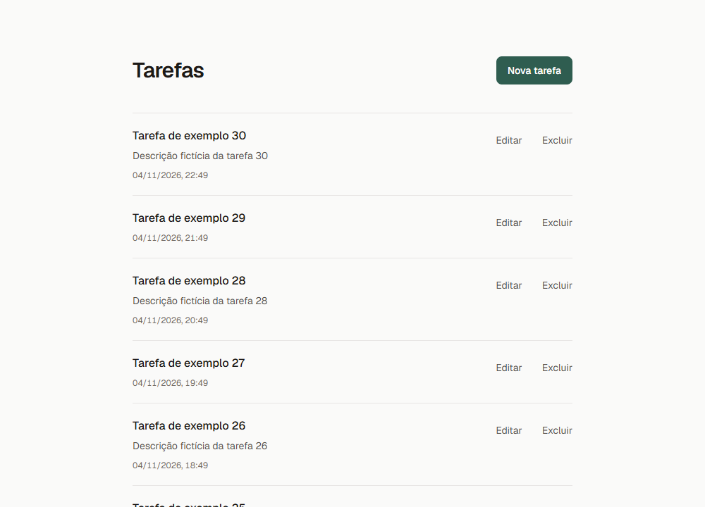
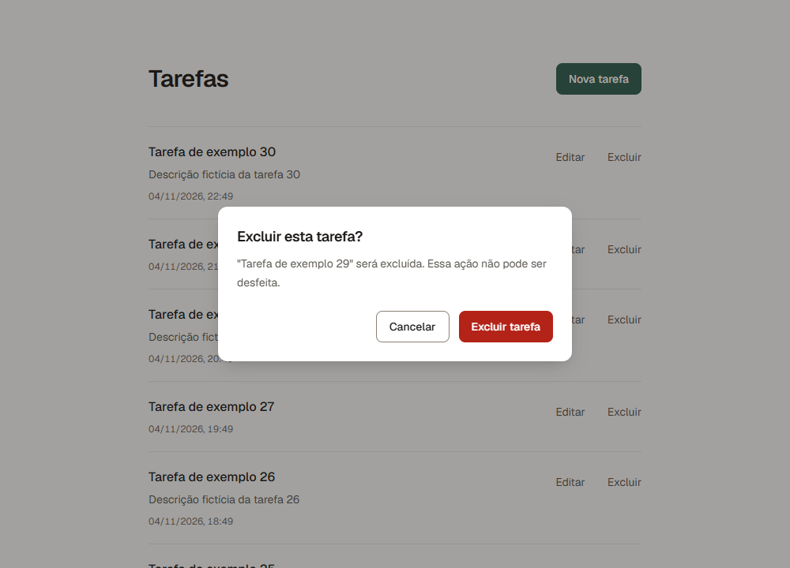
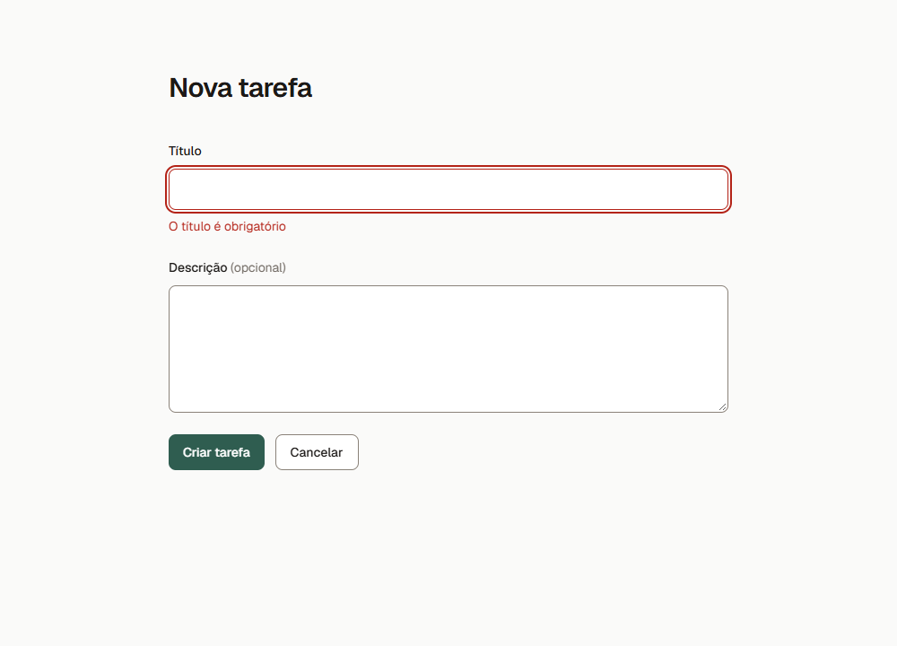
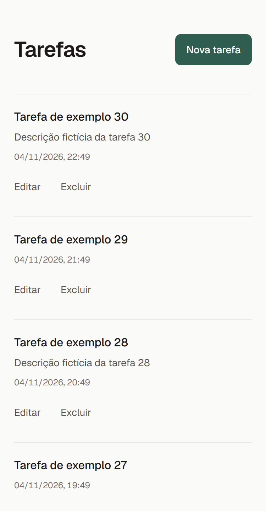
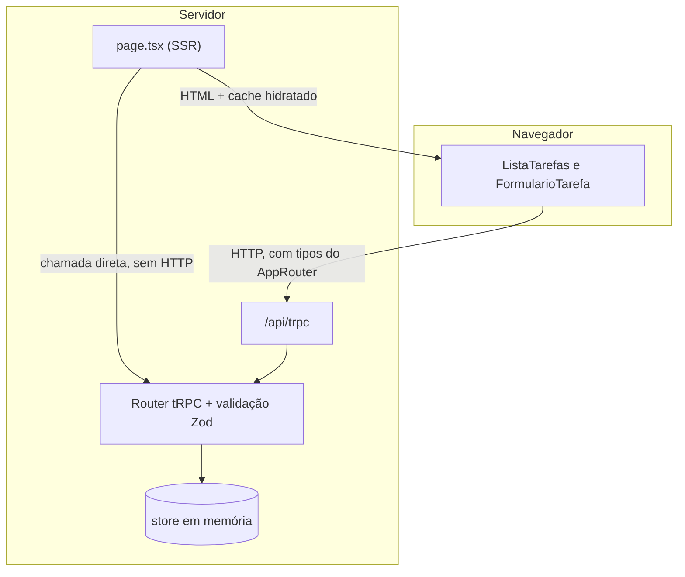

# Gerenciador de Tarefas

[](https://github.com/FelipeGuidotti/gerenciador-tarefas/actions/workflows/ci.yml)

Aplicação para criar, listar, editar e excluir tarefas, feita com Next.js 15 e tRPC. A primeira página da lista é renderizada no servidor, e as demais carregam conforme a rolagem. As tarefas ficam em memória, e todos os dados são fictícios.

| Listagem | Confirmação de exclusão |
|---|---|
|  |  |

| Validação do formulário | Celular |
|---|---|
|  |  |

## Sumário

- [Como executar](#como-executar)
- [Funcionalidades](#funcionalidades)
- [Stack](#stack)
- [Arquitetura](#arquitetura)
- [API](#api)
- [Principais decisões](#principais-decisões)
- [Testes](#testes)
- [Limitações](#limitações)

## Como executar

É preciso ter o Node.js 20 ou superior (testado na versão 24). Não há variáveis de ambiente nem banco de dados para configurar.

```bash
git clone https://github.com/FelipeGuidotti/gerenciador-tarefas.git
cd gerenciador-tarefas
npm install
npm run dev
```

Abra http://localhost:3000. O app já começa com 30 tarefas fictícias, e tudo volta a esse estado quando o servidor reinicia.

| Comando | O que faz |
|---|---|
| `npm run dev` | Inicia o servidor de desenvolvimento |
| `npm run build` | Gera a versão de produção (baixa a fonte Geist, então precisa de internet) |
| `npm start` | Inicia a versão de produção, depois do build |
| `npm test` | Roda os testes |
| `npm run lint` | Roda o ESLint |

> Não rode `npm run build` com o `npm run dev` ativo na mesma pasta. Os dois gravam em `.next`, e o servidor pode passar a responder erro 500. Se isso acontecer, pare o servidor, apague a pasta `.next` e inicie de novo.

## Funcionalidades

- **Listagem com SSR:** a primeira página chega pronta no HTML e aparece até com o JavaScript desligado.
- **Infinite scroll:** as tarefas seguintes carregam conforme a rolagem, com aviso de carregamento e opção de tentar de novo em caso de falha.
- **Criar e editar:** o mesmo formulário, com validação no navegador e no servidor, e erros exibidos abaixo de cada campo.
- **Excluir:** modal de confirmação, estado "Excluindo..." por item e mensagem de sucesso ou erro.
- **Página 404:** para rotas inexistentes e para a edição de tarefas com id inválido ou inexistente.
- **Acessibilidade:** uso por teclado, foco visível, nomes de ação que distinguem as tarefas, contraste calculado para o nível AA e redução de animação quando o sistema pede.
- **Responsividade:** funciona a partir de 320 px de largura.

## Stack

| Tecnologia | Uso |
|---|---|
| Next.js 15 (App Router) | Rotas, SSR e servidor |
| React 19 e TypeScript | Interface e tipagem |
| tRPC 11 | API com tipos compartilhados entre back e front |
| TanStack Query 5 | Cache, hidratação e paginação infinita no navegador |
| Zod 4 | Validação e geração dos tipos |
| Tailwind CSS 4 | Estilos |
| Jest e Testing Library | Testes |
| GitHub Actions | Lint, tipos, testes e build a cada push |

## Arquitetura

```text
src/
├── app/
│   ├── api/trpc/[trpc]/route.ts   Rota HTTP do tRPC
│   ├── page.tsx                   Listagem: busca os dados no servidor
│   ├── tarefas/nova/              Página de criação
│   ├── tarefas/[id]/editar/       Página de edição
│   ├── layout.tsx                 Providers e estrutura comum
│   ├── error.tsx                  Tela de erro
│   └── not-found.tsx              Página 404
├── components/
│   ├── ListaTarefas.tsx           Lista, exclusão e infinite scroll
│   ├── FormularioTarefa.tsx       Formulário de criar e editar
│   ├── DialogoConfirmacao.tsx     Modal de confirmação
│   ├── Feedback.tsx               Mensagens de sucesso e erro
│   └── estilos.ts                 Classes dos botões
├── lib/
│   └── tarefa-schema.ts           Contrato: regras e tipos da tarefa
├── server/
│   ├── tarefas/store.ts           Dados em memória
│   └── trpc/                      Inicialização do tRPC e operações da API
└── trpc/                          Acesso ao tRPC no navegador e no servidor
```

### O contrato

O contrato fica em três lugares, e nenhum é escrito duas vezes:

- **Dados:** os schemas Zod em `lib/tarefa-schema.ts`.
- **Operações:** o router em `server/trpc/routers/tarefas.ts`, exportado como o tipo `AppRouter`.
- **Erros:** o `errorFormatter` em `server/trpc/init.ts`.

### Regras de dependência

1. Só o router acessa o store.
2. Os componentes do navegador falam com o backend apenas pelo `useTRPC`.
3. Do `server/`, o front importa apenas tipos. O `server-only` faz o build falhar se isso for violado.

### Como os dados circulam



Ao abrir a lista, a `page.tsx` chama o router direto, sem passar por HTTP, e envia o HTML pronto junto com os dados. O navegador reaproveita esses dados, sem chamar a API de novo. As ações seguintes, como rolar, criar, editar e excluir, passam pela rota `/api/trpc`.

## API

Todas as operações passam por `/api/trpc/tarefas.<operação>`.

| Operação | Tipo | Entrada | Saída | Erros |
|---|---|---|---|---|
| `listar` | query | `limit?` (1 a 50, padrão 10), `cursor?` | `{ itens, proximoCursor }` | 400 |
| `buscarPorId` | query | `id` | Tarefa | 400, 404 |
| `criar` | mutation | `titulo`, `descricao?` | Tarefa | 400 |
| `atualizar` | mutation | `id`, `titulo`, `descricao?` | Tarefa | 400, 404 |
| `deletar` | mutation | `id` | `{ id }` | 400, 404 |

| Campo | Tipo | Regras |
|---|---|---|
| `id` | número | Gerado pelo servidor, inteiro e positivo |
| `titulo` | texto | Obrigatório, sem espaços nas pontas, até 120 caracteres |
| `descricao` | texto | Opcional, até 1000 caracteres |
| `dataCriacao` | texto ISO 8601 | Gerada pelo servidor |

**Exemplo de sucesso**, com o app rodando:

```bash
curl -X POST http://localhost:3000/api/trpc/tarefas.criar \
  -H "content-type: application/json" \
  -d '{"titulo":"Comprar café"}'
```

```json
{
  "result": {
    "data": {
      "id": 31,
      "titulo": "Comprar café",
      "dataCriacao": "2026-11-05T01:00:00.000Z"
    }
  }
}
```

**Exemplo de erro de validação (400)**, trecho da resposta para um título vazio:

```json
{
  "error": {
    "message": "Dados inválidos",
    "data": {
      "code": "BAD_REQUEST",
      "httpStatus": 400,
      "path": "tarefas.criar",
      "errosCampos": { "titulo": ["O título é obrigatório"] }
    }
  }
}
```

**Exemplo de tarefa inexistente (404)**, trecho da resposta:

```json
{
  "error": {
    "message": "Tarefa 9999 não encontrada",
    "data": {
      "code": "NOT_FOUND",
      "httpStatus": 404,
      "path": "tarefas.atualizar",
      "errosCampos": null
    }
  }
}
```

Em erros de validação, o detalhe de cada campo fica em `errosCampos`. Erros inesperados respondem 500 com a mensagem `Erro interno do servidor`, sem expor o texto original.

## Principais decisões

**Contrato com Zod e `AppRouter`, sem classes.** Os schemas validam ao rodar e geram os tipos, e o front importa só o tipo do router. Se um campo mudar no backend, o `tsc` aponta o erro no front. Uma classe não validaria nada ao rodar e perderia os métodos ao virar JSON.

**Sem camada de service nem interface de repository.** O router é simples e só existe uma implementação do store. Essas camadas apenas repassariam chamadas. Para trocar por um banco, a mudança fica concentrada em `store.ts`, além de alguns `await` no router.

**Paginação por cursor de `id`, sem offset.** Criar ou excluir tarefas durante a rolagem não desloca as páginas seguintes, então nada é pulado nem repetido.

**SSR com `force-dynamic`, prefetch e hidratação.** Sem o `force-dynamic`, o Next geraria a página uma única vez no build, e a lista ficaria congelada.

**Sem `loading.tsx`.** Como o store responde na hora, o HTML inicial já traz a lista. Com ele, o HTML traria "Carregando..." e dependeria de JavaScript para mostrar as tarefas. Na edição, ele também faria um id inválido responder 200 em vez de 404.

**Sem lazy loading de componentes.** O infinite scroll já carrega os dados aos poucos, o Next separa o código por rota e o app não tem imagens. O `next/dynamic` aumentaria a complexidade sem ganho perceptível.

**Só busca outra página quando nenhuma busca está em andamento.** Buscar a próxima página cancelaria uma atualização em andamento, e uma tarefa excluída poderia continuar na tela. Um teste protege esse comportamento.

**Store em `globalThis`.** O Next pode carregar o mesmo módulo mais de uma vez, e sem isso a página e a API poderiam enxergar listas diferentes.

**Fuso fixo nas datas.** Servidor e navegador em fusos diferentes gerariam textos diferentes e um erro de hidratação. Por isso, as datas sempre aparecem no horário de Brasília.

**`replace` ao salvar e ao cancelar.** Assim, o botão Voltar não reabre o formulário com dados antigos, que sobrescreveriam a edição se fossem salvos de novo.

**`<dialog>` nativo no modal.** O navegador já cuida do foco preso no modal, da tecla Esc, do bloqueio do fundo e da volta do foco, sem biblioteca.

## Testes

```bash
npm test
```

Os testes rodam com Jest e Testing Library, sem precisar de servidor:

| Arquivo | O que verifica |
|---|---|
| `lib/tarefa-schema.test.ts` | Título obrigatório, limites de tamanho e ids inválidos |
| `app/api/trpc/[trpc]/route.test.ts` | A rota real do tRPC, da validação ao store: CRUD, erros 400 e 404, e paginação com exclusão durante a rolagem |
| `components/FormularioTarefa.test.tsx` | Validação, envio único, erros do backend e falha de rede, com a API simulada |
| `components/ListaTarefas.test.tsx` | Exclusão, foco, estado vazio, falhas de carregamento e infinite scroll, com a API simulada |

A cada push na `main`, o GitHub Actions roda lint, verificação de tipos, testes e build.

Para confirmar que a suíte pega bugs, inserimos defeitos de propósito, como o cursor repetindo uma tarefa e o cancelamento de uma atualização em andamento, e os testes falharam em todos. Os fluxos também foram verificados no Chrome durante o desenvolvimento, com scripts que não fazem parte do repositório.

## Limitações

- **Dados em memória:** somem ao reiniciar o servidor, e esse armazenamento não funciona em serverless com várias instâncias. O case dispensa banco de dados e o projeto não tem deploy.
- **Atualização completa:** `atualizar` substitui os dados da tarefa, como um `PUT`. Enviar uma tarefa sem `descricao` apaga a descrição dela.
- **Horário fixo:** um usuário em outro fuso vê as datas no horário de Brasília.
- **Volta à lista:** depois de salvar ou cancelar, a lista recomeça na primeira página. Com o Voltar do navegador, as tarefas já carregadas continuam na tela.
- **Sem autenticação:** qualquer pessoa com acesso ao app pode alterar as tarefas.
- **Versão do Next:** o case cita a v15, então o projeto usa o último patch dessa linha (15.5.29), embora a v16 já exista. Nas dependências de produção, `npm audit --omit=dev` aponta uma vulnerabilidade moderada no `next` e uma alta no `postcss`, e a única correção oferecida é migrar para o Next 16. O risco prático é baixo, porque o projeto roda localmente, sem deploy. O aviso do `npm install` mostra um número maior porque inclui as ferramentas de desenvolvimento, como Jest e ESLint, que não fazem parte da aplicação.
- **Testes:** a suíte não abre um navegador real, então não pega problemas de CSS nem de hidratação. O uso com leitor de tela e em celular real não foi verificado.
